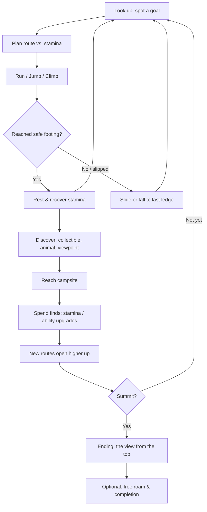

# Little Peak (codename): Game Design Document (v0.2)

**Status:** First draft, focused on the core loop
**Engine:** Godot 4.x
**Genre:** Cozy 3D platformer / exploration
**Target length:** 2–4 hours for the main climb, 5–6 hours to find everything
**Team:** Small indie team (owner: Brennan Sage)

> This doc covers the **core gameplay loop** first. Theme, story beats, and gimmicks will be layered on in later revisions. Where a choice is still open, options are listed and the recommendation is marked **[Recommended]**.

---

## 1. Overview & Pitch

**One-liner:** Climb one big, continuous mountain at your own pace, and reach the top because you wanted to.

**Pitch:** You start at the foot of a mountain with a backpack, a simple set of moves, and a peak you can see the whole time. No levels, no loading screens, no timer. You run, jump, scramble, and climb up through forests, waterfalls, cliffs, and snowfields. Along the way you get stronger, find quiet places to rest, and meet animals who live on the slopes. The summit is always in sight. How you get there is up to you.

**Touchstones:** *A Short Hike* (cozy tone, stamina feathers, one open space), *Super Mario 64* (orbit camera, satisfying movement), *Celeste* (climbing as personal achievement, gentle failure), *Breath of the Wild* (climb any surface, stamina as a planning tool).

**What makes it different:** The whole game is one vertical journey. Progress is measured in *altitude*, not levels, and the player can always look down and see how far they've come.

---

## 2. Design Pillars

1. **The summit is always visible.** The goal never hides. Every view ends at the peak, and every viewpoint shows how far you've climbed.
2. **Movement is the joy.** Running, jumping, and climbing should feel good on their own, even with nothing else to do. If the movement is dull, nothing else will fix it.
3. **Gentle challenge, never punishment.** Hard parts exist, but failure costs a little time, never progress. The mountain tests you without being cruel.
4. **Quiet discovery.** Optional paths, animals, and hidden places reward curiosity. Nothing shouts at the player.

Use these to settle arguments. If a feature doesn't serve at least one pillar, cut it.

---

## 3. Core Loop

### 3.1 Moment-to-Moment (seconds)

**Look → Plan → Move → Rest.**

- Spot a ledge, ridge, or landmark above you.
- Read the route: what can I jump to, what can I climb, how much stamina do I have?
- Run, jump, and climb toward it, spending stamina on the way.
- Reach a safe foothold, recover stamina, look up again.

The stamina bar is what makes this a loop instead of just holding "up." It turns every climb into a short decision about route and risk.

### 3.2 Session (15–40 minutes)

**Reach a new band of the mountain → explore it → find a camp → push higher.**

- Arrive in a new zone with a new look, new sounds, and new traversal challenges.
- Explore sideways as well as up: collectibles, animals, side paths.
- Find a **campsite** (checkpoint + save + rest spot with a view).
- Spend what you found on upgrades, or unlock a new route.
- Choose a path to the next zone.

Campsites are the natural place to stop a session, so a session ends at a calm, satisfying point.

### 3.3 Full Game (hours)

**Start weak at the base → grow in skill and stamina → open up the mountain → reach the summit → (optional) come back down to finish exploring.**

---

## 4. Player Movement & Abilities

The goal is a small, expressive moveset that's easy to learn and has a little depth for players who want it. All values below are starting points for tuning, not fixed specs.

### 4.1 Run

- **What:** Analog, camera-relative movement with a short acceleration ramp and quick turn-around.
- **Why:** The player spends most of the game running. It has to feel responsive and a little bouncy, never floaty or sluggish.
- **Feel notes:** Accelerate quickly (full speed in ~0.15s), stop a bit slower so it feels like it has weight. Tilt the character slightly into turns. Footstep sounds and small dust puffs that change by surface (grass, rock, snow) add a lot. Slopes should slow the player a little going uphill, and very steep slopes should make them slide rather than walk.

### 4.2 Jump

- **What:** Variable-height jump (tap for short, hold for full), with coyote time and jump buffering.
- **Why:** Jumping is the main way to cover gaps, so it has to be forgiving and easy to read.
- **Feel notes:**
  - *Coyote time* (~0.1s): can still jump just after running off a ledge.
  - *Jump buffer* (~0.1s): a jump pressed just before landing still fires.
  - Fall faster than you rise. This makes jumps feel snappy instead of floaty.
  - A **blob shadow** directly under the player is essential for judging landings in 3D. Don't skip it.
- **Optional depth:** A small **long jump** (jump out of a crouch-slide) for speedier players. Nice to have, not required.

### 4.3 Climbing

This is the signature verb. There are three options:

| Option | Description | Pros | Cons |
|---|---|---|---|
| **A. Climb anything** | Any steep surface can be climbed, limited by stamina | Total freedom, emergent routes | Hard to design around, can skip content |
| **B. Climbable surfaces only** | Only marked surfaces (vines, rough rock, cracks) | Easy to design paths, clear readability | Can feel restrictive, "why can't I climb this?" |
| **C. Hybrid [Recommended]** | Most natural rock is climbable with stamina; smooth/wet/icy surfaces aren't; special holds give bonuses | Freedom plus authored routes | Needs clear visual language |

- **Why hybrid:** It keeps the freedom that makes climbing feel personal, and still lets the team block shortcuts and steer players through good routes using materials the player can learn to read (smooth wet stone = no, rough rock = yes, vines = cheap to climb).
- **Feel notes:** Climbing should be slower than running and feel deliberate. Add a short **climb hop** (jump while climbing) that costs a big chunk of stamina, so players choose between slow and safe or fast and expensive. Mantling onto ledges should happen automatically and smoothly. A missed mantle is the most annoying thing a climbing game can do.

### 4.4 Stamina

- **Recommended:** Yes, use stamina. It's what turns climbing into a decision.
- **How it works:** Stamina drains while climbing, climb-hopping, and gliding. It refills quickly whenever the player is standing on solid ground. Running and normal jumping are **free**.
- **Display:** A small ring or row of icons near the character that only appears when stamina is in use. No permanent HUD clutter.
- **Running out:** The character lets go and slides or falls. Give a clear warning first (bar flashes, the character's breathing gets heavier, the controller rumbles).
- **Why:** Stamina gives the vertical world a "budget." It also gives progression something clear to upgrade.

### 4.5 Gliding & Other Traversal Options

Pick **one** secondary traversal tool for the main game. More can be added later as gimmicks.

| Option | Fit | Notes |
|---|---|---|
| **Glide (cloak/kite/wings) [Recommended]** | Excellent | Lets players drift back down the mountain to explore, and makes high places worth reaching. Proven in *A Short Hike*. |
| Grappling / rope anchor | Good | Strong climbing theme, but harder to aim and tune in 3D. Good later unlock. |
| Wall-jump | OK | Familiar platformer move, but can make climbing feel unnecessary. |
| Ice axe / crampons | Thematic | Works as an *upgrade* for icy zones rather than a separate move. |

- **Why glide:** Going *down* matters in a one-mountain game. Gliding turns descending into a reward instead of a chore, and pairs naturally with exploration.
- **Feel notes:** Slow, gentle fall with wide turns. Small updrafts (from waterfalls, cliff edges, warm rocks) give lift and act as natural routes. Gliding uses a slow drain of stamina so it can't go on forever.

### 4.6 Moveset Summary

| Move | Cost | Available from |
|---|---|---|
| Run | Free | Start |
| Jump | Free | Start |
| Climb | Stamina (slow drain) | Start |
| Climb hop | Stamina (big chunk) | Start |
| Glide | Stamina (slow drain) | Zone 1, wings gifted by a bird |
| Long jump | Free | Start (optional depth) |

---

## 5. Camera

- **Style:** Third-person orbit camera, controlled with the right stick or mouse, like *Super Mario 64* or *A Short Hike*.
- **Default behavior:** Follows behind the player at a comfortable distance, slightly above, and slowly drifts back behind them while running. Players can always override it.
- **Climbing:** Pull out slightly and tilt so the player sees the wall *and* the route above. Never sit right against the wall.
- **Collision:** When terrain gets between camera and player, move the camera in smoothly, don't snap. Thin objects (tree trunks, poles) should fade out instead of blocking.
- **Framing the summit:** At authored viewpoints (campsites, ledges), the camera can gently suggest a view of the peak. This supports Pillar 1. Keep these subtle and skippable.
- **Options:** Invert X/Y, sensitivity, and auto-recenter on/off. These are cheap to add and players expect them.

**Godot note:** A spring-arm style setup that pulls the camera in when it hits terrain is the standard approach and fits this well. Spend real time tuning it. A bad camera will ruin good movement.

---

## 6. Progression

The player gets better in two ways: **the character grows** (stamina, abilities) and **the player grows** (skill, knowledge of the mountain).

### 6.1 Collectibles

| Collectible | Purpose | Notes |
|---|---|---|
| **Stamina tokens (e.g. feathers, chalk, trail markers) [Recommended core]** | Each one (or each set) adds stamina | The main upgrade path. Some are on the main path, many are hidden. |
| **Coins/shells/seeds** | Minor currency | Spent at a few NPCs on cosmetics or small upgrades. Optional. |
| **Journal entries / photos** | Lore and reflection | Found at viewpoints. Supports the personal-achievement theme. No gameplay power. |

**Recommendation:** Keep it to **one main upgrade collectible** plus at most one minor currency. More systems means more design and UI work for a small team.

### 6.2 Ability Unlocks

- **Glide:** **[Decided]** Unlocked in Zone 1. A bird (the Wings NPC) gifts the player wings, which they use to glide. See 8.1.
- **Grip upgrade:** Climb wet surfaces (opens waterfall routes).
- **Crampons/ice axe:** Climb ice (needed for the summit zone).
- Unlocks should come from **people and places on the mountain**, not menus, so each one feels like a small story moment.

### 6.3 Soft Gating

The mountain should feel open while still guiding the player. Options:

- **Stamina gating [Recommended primary]:** Some cliffs are just too tall for a beginner's stamina. Players can see the route, and know they'll be back. Skilled players may find a clever way up early. That's fine and should be celebrated.
- **Surface gating:** Wet or icy walls need a specific upgrade. Use sparingly, mostly near the top.
- **Environmental gating:** A frozen waterfall, a path blocked by snow, an animal that won't move until you help it. Good for story beats.
- **Avoid:** Locked doors, keys, and "you need 30 stars" walls. They break the feeling of one natural mountain.

**Rule of thumb:** A determined player should be able to reach the summit with roughly **50–60% of stamina upgrades**. Everything beyond that is for players who want to explore.

---

## 7. Failure & Risk

Failure should cost a few seconds, never progress or items.

- **Falling:** No fall damage. Long falls end in a soft landing (tumble animation, quick recovery). Gentle fall is the default. **[Recommended]**
  - *Alternative:* Very long falls into "out of bounds" areas (deep chasms, water) fade out and return the player to the last safe ledge. Use only where falling would be confusing.
- **Running out of stamina:** You slide or drop. The cost is the climb you have to redo, which is usually short.
- **Water:** Swimming is allowed in calm water. Fast rivers carry the player downstream to a safe bank instead of killing them.
- **No health, no lives, no game over.** **[Recommended]**
- **Hazards:** Mostly environmental and readable: slippery ice, crumbling rock, strong wind near the top. Hazards push you back; they don't punish you.
- **Frustration safety net:** If a player fails the same climb many times, an NPC or nearby campsite could offer a hint, or a nearby alternate route could become more visible. Never auto-skip.

The emotional goal: falling should feel like part of climbing, not a punishment. The player should think "let me try that again," not "ugh."

---

## 8. Mountain Layout

One continuous mountain, built as a single world with streaming or careful occlusion rather than separate levels. Each zone has a clear identity in look, sound, wildlife, and traversal challenge. Total vertical climb should feel big but be crossable in a few hours.

| Zone | Altitude | Look & Feel | Traversal Focus | Wildlife / Landmarks |
|---|---|---|---|---|
| **1. The Foothills** | Base | Meadows, a small village or trailhead, gentle slopes | Learn running, jumping, short climbs | Deer, rabbits, the Wings NPC bird. Tutorial zone. Glide unlocked here (see 8.1). |
| **2. The Forest** | Low | Tall pines, streams, mossy boulders | Climbing trees and rocks, first stamina tests | Birds, foxes, a big old tree to climb |
| **3. The Falls** | Mid | Waterfalls, gorges, mist, rope bridges | Wet surfaces, updrafts for gliding, river routes | Otters, herons. Grip upgrade found here. |
| **4. The Cliffs** | Upper-mid | Bare rock faces, narrow ledges, big views | Long climbs, stamina planning, climb-hop routes | Mountain goats (who show safe routes), eagles |
| **5. The Snowline** | High | Snow, ice, wind, sparse trees | Ice climbing (crampons), wind as a hazard and helper | Marmots, a hermit's cabin, frozen waterfall |
| **6. The Summit** | Peak | Thin air, clouds below, quiet | A final climb combining every skill, but not the hardest part of the game | Nothing but the view |

**Layout principles:**

- **Spiral or zig-zag routes** wrap around the mountain so players see new sides and new views as they climb.
- **Multiple paths** between zones: an easier main trail and harder, faster shortcuts.
- **Landmarks** visible from far away (a giant tree, a big waterfall, a cabin with smoke) help players navigate without a map.
- **Shortcuts back down** (zip lines, glide launch points, slides) make returning to lower zones quick.
- **Campsites** at least once per zone, plus a few hidden ones. See 8.2 for how they unlock.

### 8.1 Zone 1: The Foothills (Tutorial) **[Decided]**

The Foothills are a tutorial area where the player practices the controls before entering Zone 2. The full area isn't designed yet; this lists the features Zone 1 introduces.

| Feature | How it's introduced |
|---|---|
| Running and camera | Open meadow paths with gentle slopes |
| Jumping | Small gaps and low ledges, safe to miss |
| Climbing and stamina | Short Climbable rock faces, plus Unclimbable surfaces so the player learns to read which is which |
| Glide | A bird (the Wings NPC) gifts the player wings; nearby drops let them try gliding right away |
| Campsites | The first campfire, where the player learns to roast a marshmallow to unlock it (see 8.2) |

The player should leave Zone 1 able to run, jump, climb, glide, and use campsites.

### 8.2 Campsites **[Decided]**

- **Unlocking:** The player walks up to a campsite's campfire and presses **E** to roast a marshmallow. That unlocks the campsite.
- **Fast travel:** Unlocked campsites can be selected on a map to teleport there. The map isn't designed yet.
- **Testing:** In the test scene, unlocked campsites get teleport buttons in place of the map.

**Map option:** A map exists at least for campsite fast travel (8.2). Whether it also shows the world (a hand-drawn map the player fills in) or stays minimal, with landmarks and a compass for navigation, is still open. Decide after the first playable zone.

---

## 9. The Ending

The summit should be quiet and personal, not a boss fight.

- **Final climb:** A short, beautiful climb that uses everything the player knows. It should feel like a victory lap, not a skill test.
- **At the top:** The music drops away. The camera pulls back slowly to show the whole mountain below, with each zone visible. The player can sit down.
- **Reflection:** Show the route the player actually climbed as a faint line down the mountain, or show the journal entries and photos they collected. **[Recommended: the route line. It's personal and unique to each player.]**
- **Characters:** NPCs met along the way could appear at their spots below, waving, or send a final message.
- **After:** Credits roll over the view, then the player is free to glide down and keep exploring. Optional sunrise/sunset variation if they summit again.
- **No twist needed.** The achievement *is* the ending.

---

## 10. Open Questions for the Team

1. **Who is the player character?** An animal (like *A Short Hike*), a person, or a deliberately abstract figure? Affects animation scope a lot.
2. **Why are they climbing?** Keep it unspoken, or add a light personal story (a promise, a memory, a goal)?
3. **Climbing model:** Confirm the hybrid approach. How many surface types can we clearly communicate visually?
4. **Stamina upgrade collectible:** What is it, thematically? Feathers, trail markers, chalk, carabiners?
5. **Day/night or weather:** Does time pass? Is weather dynamic, or set per zone?
6. **NPC density:** How many characters, and how much dialogue can we write and support?
7. **World streaming:** Can one continuous mountain run well on our target hardware in Godot, or do we need a few hidden transitions (e.g. cave tunnels between zones)?
8. **Platforms:** PC only, or Switch / Steam Deck too? Affects art budget and performance targets.
9. **Gimmicks:** Which theme mechanics come next? (Photography, rope/belay system, animal companions, weather.)
10. **Accessibility:** Assist options like infinite stamina, slower drain, or a "show route" hint?

---

## 11. Title Suggestions

> All are placeholders. Check for trademark and store conflicts before committing. Note: *Cairn* is already a 2026 climbing game, so it's not listed here.

1. **Switchback** — Named after the zig-zag trail; short, memorable, and hints at the winding route.
2. **Treeline** — The point where the forest ends and the real climb begins; calm and natural.
3. **The Long Way Up** — Warm and reflective; frames the journey as the point.
4. **Ridgeline** — Clean and outdoorsy; suggests big views and open skies.
5. **Above the Clouds** — Promises the summit moment directly; very cozy.
6. **Highpoint** — A climbing term and a quiet nod to personal achievement.
7. **Foothold** — About small steps and steady progress; fits the gentle failure tone.
8. **Summit Day** — What climbers call the final push; adds a sense of occasion.
9. **One Mountain** — States the scope plainly and confidently; good for a minimal brand.
10. **Little Peak** — Cute and cozy; pairs well with an animal protagonist.

**Top picks:** *Switchback*, *The Long Way Up*, *Treeline*.

---

*Next revision: lock the player character and climbing model, then define theme and the first gimmick layer.*

---

## 12. Reusable Scenes

Building blocks to make once in the test scene and reuse across the game.

| Scene | Purpose |
|---|---|
| **Player** | The player character and its full moveset (section 4) |
| **Climbable** | A collision shape the player can climb. It can be set to a concave, convex, or primitive shape. |
| **Unclimbable** | A collision shape the player can't climb. It can be set to a concave, convex, or primitive shape. |
| **Wings NPC** | The bird in Zone 1 that gives the player wings for gliding |
| **Campsite** | A campfire where pressing E roasts a marshmallow and unlocks the campsite for fast travel (8.2) |
